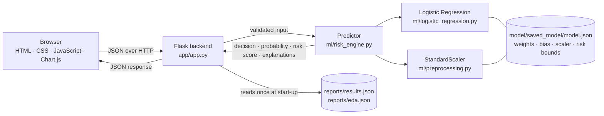
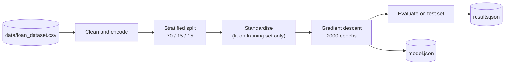

# AI Loan Prediction


A web application that predicts loan approval and assesses financial risk. The classifier is **Logistic Regression trained with batch gradient descent, written from scratch in NumPy**. No scikit-learn model, scaler or metric is used, and the confusion matrix, ROC curve and AUC are also implemented by hand.

**Live demo:** https://ai-loan-prediction-dvnp.onrender.com
*(hosted on a free plan, so the first load after a period of inactivity can take up to a minute)*

## Features

- Predicts **Approved / Rejected** with the approval probability and a confidence level
- Computes a transparent **risk score (0 to 100)** with Low, Medium and High bands
- Explains each decision with rule-based factors and per-feature model contributions
- **What-If simulator** that re-runs the trained model on an improved profile, with no retraining
- Warns when an input is outside the range seen during training
- Dashboard, model-performance and dataset-insight pages, built from saved results
- Input validation on the API and a set of automated sanity tests

## Architecture



**Training (offline)**



The model is trained once by `training/train.py`. The web server only loads the saved weights and performs a forward pass for each request.

## How the model works

1. Each input is standardised: `z = (x - mean) / std`, using statistics from the training set only.
2. A weighted sum is computed: `s = w1·z1 + ... + w11·z11 + b`.
3. The sigmoid turns it into a probability: `p = 1 / (1 + e^(-s))`.
4. The loan is **Approved** if `p >= 0.5`, otherwise **Rejected**.
5. Training minimises binary cross-entropy with L2 regularisation using batch gradient descent: `W ← W − α · (Xᵀ(p − y)/n + λW)`.

Settings: learning rate 0.1, 2000 epochs, L2 λ = 0.001, threshold 0.5, 11 input features.

## Results

Measured on a held-out test set of 642 applications that was not used for training or for choosing λ.

| Metric | Value |
|---|---|
| Accuracy | 92.37% |
| Precision | 93.32% |
| Recall | 94.49% |
| F1-score | 93.90% |
| ROC-AUC | 0.9761 |

Confusion matrix: TN 216, FP 27, FN 22, TP 377. Training accuracy is 92.14% and test accuracy is 92.37%, so the model is well fitted.

## Dataset

4,269 loan applications, 13 columns (62.22% approved), with no missing values or duplicates. Preprocessing: stripped whitespace, dropped `loan_id`, clipped 28 negative asset values to 0, encoded categorical columns and standardised the features. Details are in `ml/preprocessing.py` and `analysis/eda.py`.

## Risk score

```
Risk = 100 × [0.45(1 − P) + 0.25(1 − Credit) + 0.15·Burden + 0.10(1 − Assets) + 0.05(1 − Income)]
```

`P` is the model's approval probability, `Credit = (CIBIL − 300) / 600`, and `Burden`, `Assets` and `Income` are scaled between the 5th and 95th percentile of the training data. Bands: 0 to 30 Low, 31 to 60 Medium, 61 to 100 High. This is a score defined for this project, **not** an official credit score.

## API

| Method | Endpoint | Description |
|---|---|---|
| GET | `/` | Web interface |
| GET | `/api/bootstrap` | Saved dataset summary and training results |
| POST | `/api/predict` | Applicant data in, prediction, risk score and explanations out |
| POST | `/api/simulate` | Current and improved profiles in, both predictions and the change out |

Example request:

```bash
curl -X POST http://127.0.0.1:5000/api/predict \
  -H "Content-Type: application/json" \
  -d '{"dependents":2,"education":"Graduate","self_employed":"No","income":5000000,
       "loan_amount":15000000,"loan_term":12,"cibil":750,
       "residential":2000000,"commercial":3000000,"luxury":10000000,"bank":4000000}'
```

Invalid input (non-numeric, negative, CIBIL outside 300 to 900) returns a JSON error with status 400.

## Getting started

```bash
git clone https://github.com/rajjaiswal2057-ui/AI-Loan-Prediction.git
cd AI-Loan-Prediction
pip install -r requirements.txt
python app/app.py
```

Then open http://127.0.0.1:5000. The trained model is included, so no training is needed.

To reproduce the results:

```bash
pip install -r requirements-train.txt   # adds matplotlib
python analysis/eda.py                  # dataset audit, writes reports/eda.json
python training/train.py                # trains and writes model.json and results.json
python tests/test_project.py            # sanity tests
```

## Project structure

```
AI-Loan-Prediction/
├── app/
│   ├── app.py                 Flask backend and API
│   ├── templates/index.html   Single-page interface
│   └── static/                JavaScript, CSS, Chart.js (bundled, works offline)
├── ml/
│   ├── logistic_regression.py Sigmoid, loss, gradient descent, L2
│   ├── preprocessing.py       Cleaning, encoding, scaler, stratified split
│   ├── metrics.py             Confusion matrix, precision, recall, F1, ROC, AUC
│   └── risk_engine.py         Prediction, risk score, explanations, What-If
├── training/train.py          Training, L2 study, feature ablation
├── analysis/eda.py            Exploratory data analysis
├── tests/test_project.py      Sanity tests
├── data/loan_dataset.csv
├── model/saved_model/model.json
├── reports/                   Figures, results.json, eda.json
├── requirements.txt
├── requirements-train.txt
├── Procfile · render.yaml     Deployment configuration
└── LICENSE
```

## Limitations

- In this dataset approval follows the CIBIL score almost like a cut-off (about 550), so the other features add very little.
- Two ratio features (loan-to-income, assets-to-loan) were tested and gave no improvement, so the model uses the 11 raw features.
- Loan-to-income only ranges from 1.5x to 4.0x in the data; the app warns when inputs fall outside the training range.
- The risk score is a heuristic and has not been validated against real repayment data.
- No cross-validation, comparison with other algorithms or fairness audit has been done yet.

This is an educational project and must not be used for real lending decisions.

## Future work

- k-fold cross-validation and comparison with k-NN, decision trees and a small neural network
- Probability calibration and a fairness analysis
- A larger real-world dataset

## License

Released under the [MIT License](LICENSE).
